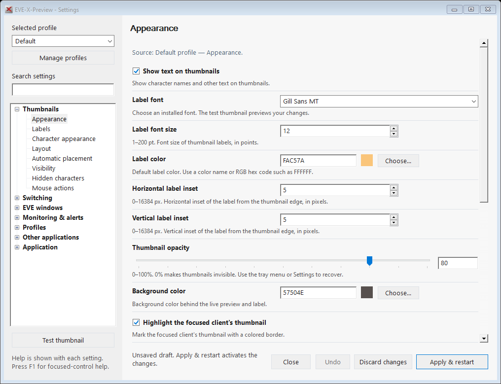

# EVE-X-Preview

A Windows tool for managing multiple EVE Online clients with live thumbnails, mouse gestures and window-switching hotkeys.

- Click a thumbnail or press a shortcut to activate a client.
- Organize characters into hotkey groups and switch between settings profiles.
- Customize labels, colors, borders, sizes and placement.
- Monitor supported game-log events, systems and DPS, with optional sound alerts.
- Use anonymous thumbnail labels, position locking and configurable preview optimization.

[Download the latest release](https://github.com/khivus/EVE-X-Preview/releases) · [Changelog](Changelog.md) · [Report an issue](https://github.com/khivus/EVE-X-Preview/issues/new) · [Discord](https://discord.gg/d9EzgUXnT6)

 <em>Settings workbench shown with sample data.</em>

## Documentation

- [Getting started](docs/getting-started.md)
- [Settings workbench, search and Apply/Discard](docs/settings.md)
- [Hotkeys and groups](docs/hotkeys.md)
- [Mouse gestures](docs/mouse-gestures.md)
- [Tray menu](docs/tray-menu.md)
- [Profiles and overrides](docs/profiles.md)
- [Thumbnail appearance and custom colors](docs/thumbnail-appearance.md)
- [Thumbnail behavior, visibility and position lock](docs/thumbnail-behavior.md)
- [Anonymous labels and editable random-name list](docs/anonymization.md)
- [Thumbnail optimization and DWM limits](docs/optimization.md)
- [Test thumbnail](docs/test-thumbnail.md)
- [Client settings](docs/client-settings.md)
- [Game logs, events and DPS](docs/game-log-monitoring.md)
- [Application and advanced settings](docs/other-settings.md)
- [Updates and diagnostics](docs/updates-and-diagnostics.md)
- [Source setup, tests and contributing](docs/development.md)

Guides live in `docs/` so each page can be linked directly and updated with the matching code release.

## Scope

* It does not broadcast keyboard or mouse input to multiple clients.
* It does not send individual input to clients in the way input broadcasting tools do.
* It does not display cropped client content as thumbnails.
* It does not manipulate the game client itself.

EVE-X-Preview does not interact directly with the game client. It only changes the foreground window using hotkeys and thumbnails.
No features will be added now or in the future that intentionally break the EVE Online EULA or Terms of Service.

## Third-party tool notice

As I understand the EVE Online EULA and Terms of Service, this tool does not break any rules.
Since EVE-X-Preview uses the same method as [EVE-O Preview](https://github.com/EveOPlus/eve-o-preview), a similar tool that is permitted, I assume the same applies here.
Nevertheless, using EVE-X-Preview or any other third-party tool is always at your own risk.

**I assume no liability whatsoever.**

## Contributing and credits

Pull requests target [`dev`](https://github.com/khivus/EVE-X-Preview/tree/dev); see the [development guide](docs/development.md).

Created by [gonzo83](https://github.com/g0nzo83/EVE-X-Preview), forked and maintained by [khivus](https://github.com/khivus). Credits to [mrmjstc](https://github.com/mrmjstc/eve-maj-preview) and [CJKondur](https://github.com/CJKondur/EVE-MultiPreview).
