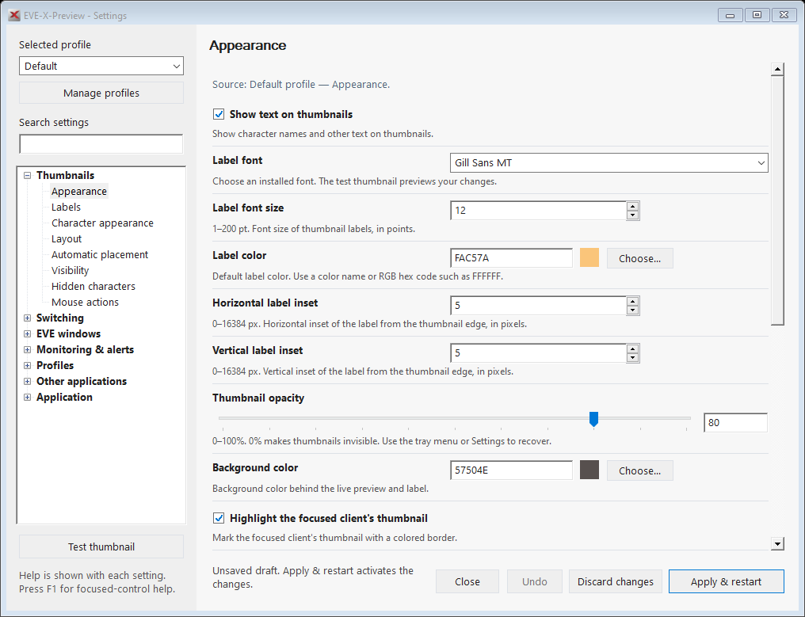
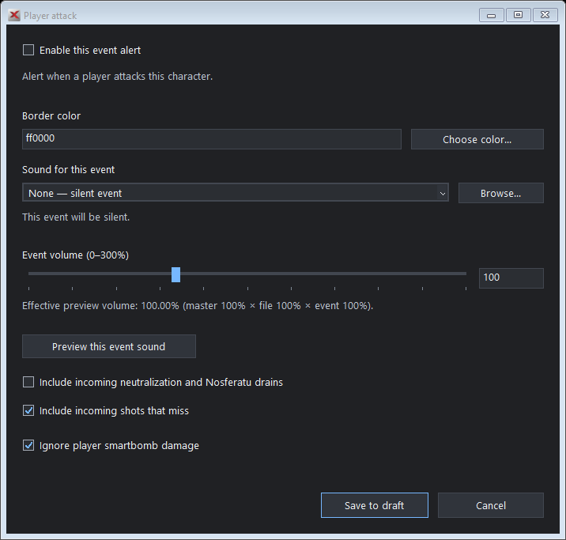
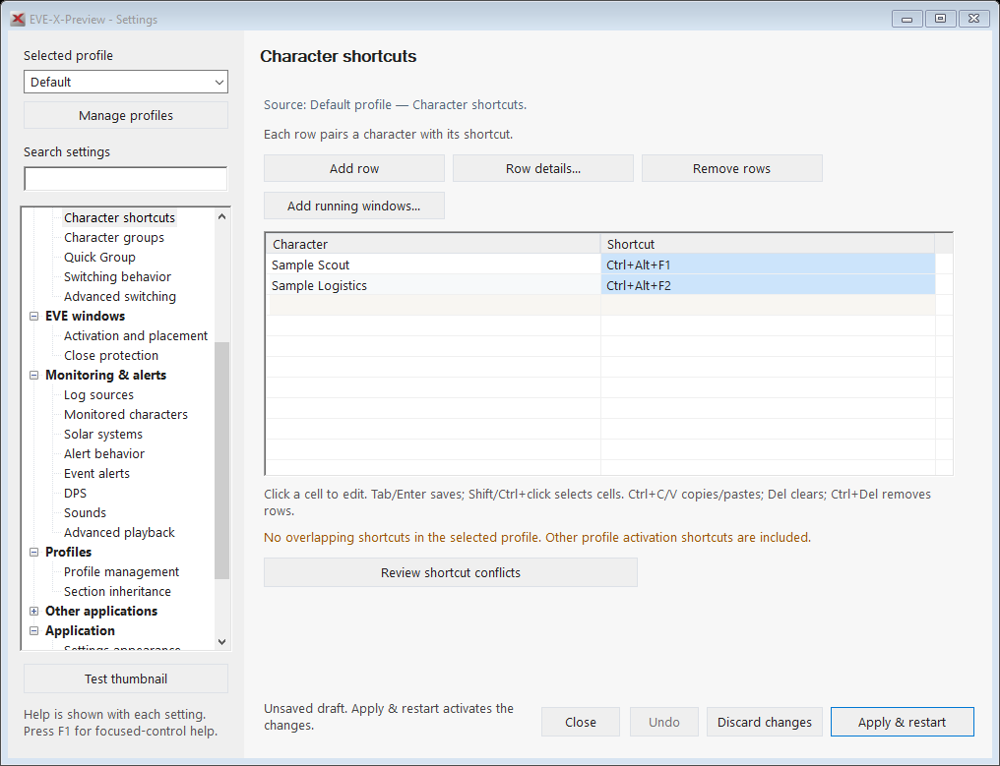
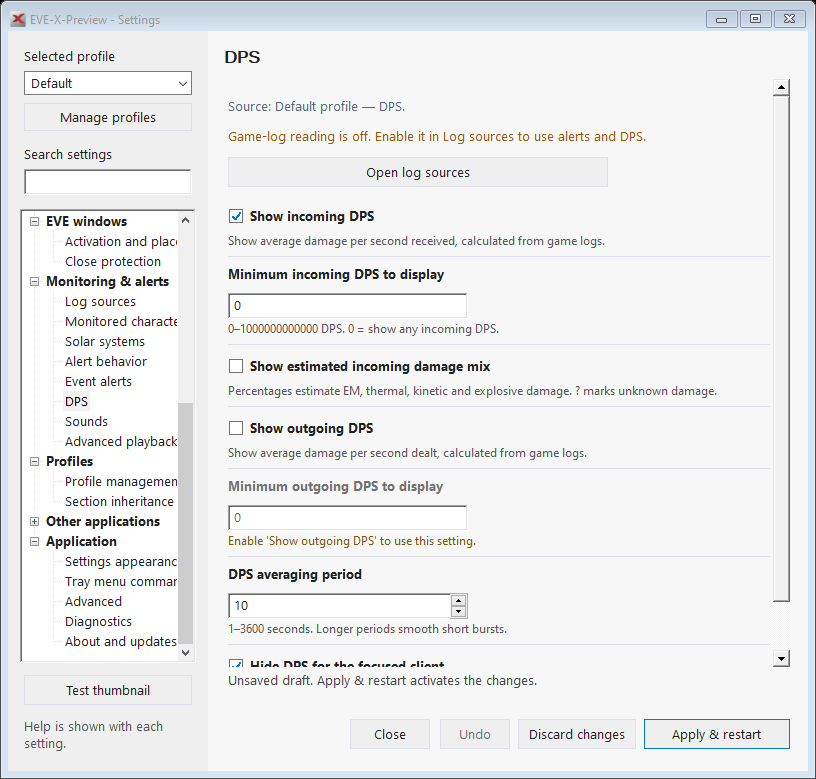
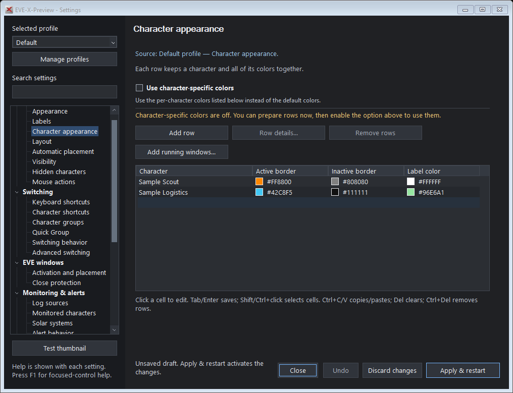
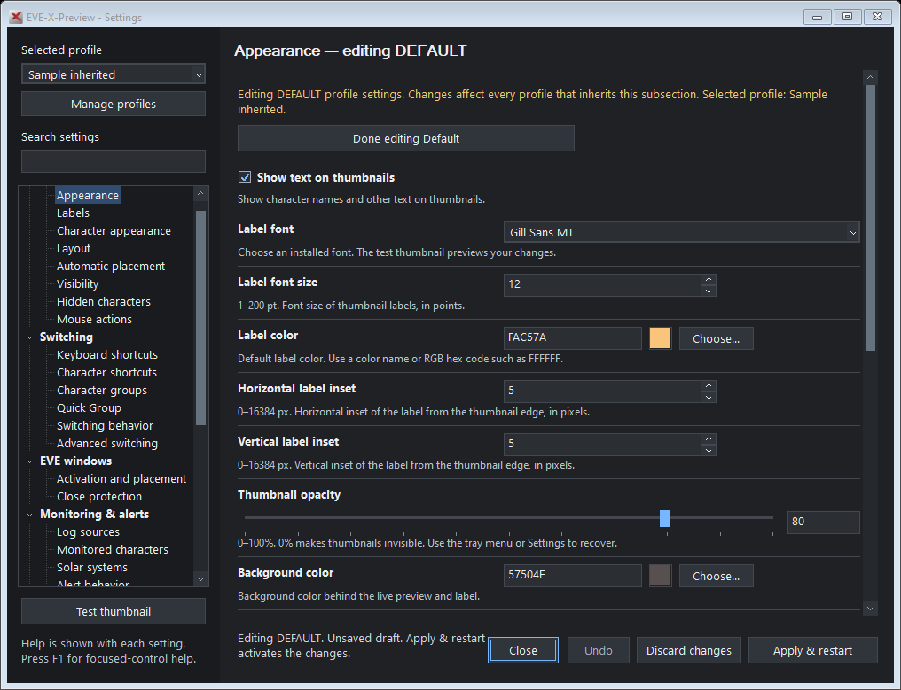

# Settings workbench

[Back to README](../README.MD)

Settings uses an isolated draft. Editing a field, adding a row, changing inheritance or selecting a profile does not change the running application.

- **Apply & restart** validates the draft, saves it and restarts EVE-X-Preview once. This activates the staged settings and selected activation profile.
- **Discard changes** restores the current running configuration in the editor.
- **Close** or Escape asks whether to apply, discard or keep editing when a draft is unfinished.
- Invalid values stay visible with an explanation. **Fix fields** locates the first problem, including edits in another profile. Values are never silently clamped by the workbench.
- **Undo** restores the last removed row, group, profile or library reference. Later row edits are preserved.

## Find a setting

The navigation has seven areas with subsections:

| Area | Contents |
| --- | --- |
| Thumbnails | Appearance, labels, character colors, layout, automatic placement, visibility, hidden characters and mouse actions |
| Switching | Keyboard shortcuts, character shortcuts, character groups, Quick Group, switching behavior and advanced focus retries |
| EVE windows | Activation, placement, Close all protection and per-character exceptions |
| Monitoring & alerts | Log sources, monitored characters, solar systems, alert behavior, event alerts, DPS, sounds and advanced playback |
| Profiles | Profile management, activation shortcuts and section inheritance |
| Other applications | Application groups and individual executable/title/shortcut assignments |
| Application | Settings theme, tray commands, advanced compatibility/performance, diagnostics, About and updates |

Search matches setting labels, help and event-specific terms such as smartbomb, Nosferatu and executable. Selecting another subsection preserves its scroll position. The navigation selection remains visible while editing a field. The window can be resized and initially fits the monitor work area; long forms and child editors scroll vertically.

Matching words are highlighted in visible labels, descriptions, dropdowns and table values. Search reveals the first matching setting label or explanation and leaves editable values and their selection unchanged.

[Search highlighting example](images/settings-search.png)

Descriptions, units, ranges, prerequisites and inheritance are visible beside the controls. Hover help is supplemental. Press **F1** on a focused control for its help.

**Application → Settings appearance** offers **Use Windows setting**, **Light** and **Dark**. The palette previews immediately across Settings and its row/event editors. Apply saves the choice; Discard restores it. This shared preference does not change thumbnail colors. Windows file and color pickers retain their system appearance.

Inherited subsections offer **Edit Default here**. It edits the shared Default values while retaining the selected profile in the sidebar. The pinned title, warning and footer identify DEFAULT as the target. **Done editing Default** returns to the selected profile without applying or restarting. See [Profile inheritance](profiles.md#inheritance).

## Edit structured lists

Character shortcuts, colors, labels, exceptions, group members and application assignments use editable grids. Click a cell and type. **Add row** focuses the empty entry row; entering data creates another entry row. Rows without a character, executable or other target are ignored without warnings. Clearing an existing target removes its paired assignment. Nonempty invalid targets and invalid values in identified rows stay visible across navigation and resizing and block Apply until corrected or removed.

| Interaction | Result |
| --- | --- |
| Click a cell / Enter / F2 | Edit that cell inline |
| Tab / Shift+Tab | Save and move to the next/previous editable cell |
| Enter / Escape while editing | Save / cancel that cell edit |
| Shift+click or Shift+arrow | Select a rectangular cell range |
| Drag or Ctrl+drag across cells | Toggle the rectangular range against its previous selection; selected cells become unselected |
| Ctrl+click | Add or remove individual selected cells |
| Click a column heading | Select that column's existing cells |
| Ctrl+A | Select all existing cells |
| Ctrl+C / Ctrl+V | Copy/paste tab-separated cells, including rectangular blocks from a spreadsheet |
| Type `1` or `0` with several cells selected | Fill selected cells; useful for Yes/No columns |
| Ctrl+Enter while editing | Fill the selected cells with the entered value |
| Delete | Clear editable selected cells |
| Ctrl+Delete / Remove rows | Remove selected rows; Undo restores the assignments |

Readonly columns retain their values during paste. Copying shortcut cells uses their original AutoHotkey syntax. Gesture and other choice cells open their dropdown on a single click. Mouse selection keeps the settings pane at its current scroll position. **Row details** remains available for shortcut recording, color pickers and other specialized controls. Ordered groups have adjacent **Move up/down** buttons.

Color columns show the actual color beside its hex value. The swatch updates after a valid cell edit and retains the same RGB color in both interface themes.

Color fields outside tables also repaint their preview immediately after valid typing or color selection. Validation text and color update together; default/minimum thumbnail size mismatches identify both affected fields and clear when corrected. Invalid shortcut rows remain editable on the current page when you choose **Row details**.

Under **Application → Settings appearance**, choose System, Light or Dark. The dark palette also covers tooltips, dropdowns, field/table borders, scrollbars, spinner buttons and slider tracks. Switching themes previews immediately; Apply saves the choice. Windows file and color pickers retain their system appearance.

Event names stay fixed; enabled state, color, sound path and volume edit inline. Use **Event details** for event-specific conditions and sound browsing. Shared sound files accept pasted full paths and editable gain; removing references preserves event assignments and original files. Inheritance and batch sound tables support the same cell selection and bulk values. Running-window pickers support multiple selection and copying.

**Add running windows** lets you select actual EVE characters or applications while retaining existing assignments. Duplicate targets and profile/group names cannot overwrite existing data. Character exceptions are under **EVE windows → Close protection**.

Setting labels are emphasized and separated from adjacent rows. Help wraps to its measured height. Inherited and unavailable labels are consistently muted. Each subsection's source controls appear before its description; see [Profile inheritance](profiles.md#inheritance). Navigation groups remain expanded until explicitly collapsed, and the sidebar fills the window height. Slider scales have about ten divisions. During dragging, values change in steps of five and the thumb follows the mouse smoothly; it snaps to the final value on release. The adjacent numeric fields accept exact values.

Slider marks belong to the slider's paint rather than overlapping controls. Settings editors and color pickers center over their owner within that monitor's work area. Stacked actions share a width, and About displays aligned installed, stable and pre-release version rows.

## Preview and immediate actions

**Test thumbnail** previews the draft with sample states and does not join the live client list. Sound preview buttons play draft volume settings without saving them. The tray's **Pause/Resume Live Previews**, diagnostic actions, documentation links and update checks are immediate commands. Installers require a clean draft and explicitly identify downgrades.

Runtime window positions and discovered character IDs are preserved when the draft is applied. Profile activation, reload and exit requests cannot silently discard an open draft.

## Native interface examples

These captures use isolated fixture settings and sample character names. They do not show a live EVE session.

